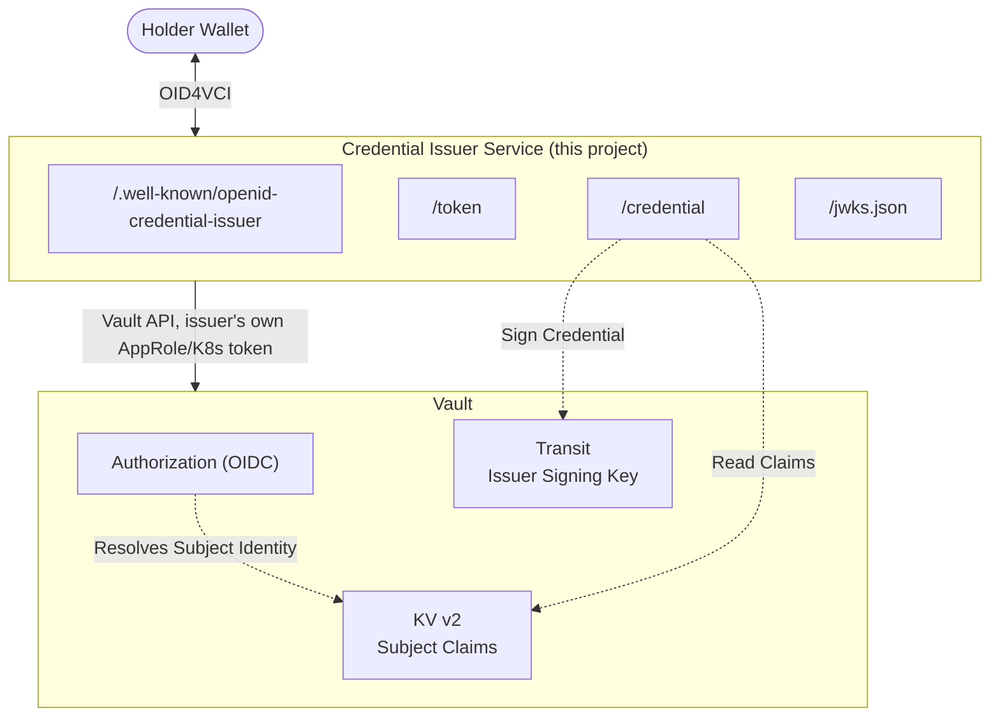

# nessus-oid4vc-go

A Go implementation exploring [OpenID for Verifiable Credential Issuance
(OID4VCI)](https://openid.net/specs/openid-4-verifiable-credential-issuance-1_0.html)
and [OpenID for Verifiable Presentations
(OID4VP)](https://openid.net/specs/openid-4-verifiable-presentations-1_0.html),
with the long-term goal of enabling **HashiCorp Vault** to act as an
OID4VC Issuer.

## Why Vault

Vault already provides strong, pluggable authentication (OIDC, userpass,
AppRole, ...) and secure secret storage. Before changing anything inside
Vault itself, this repo builds a standalone proof of concept that uses an
*unmodified* Vault as:

- the **authentication** backend for credential subjects (via Vault auth
  methods and Identity entities), and
- the **data source** for the claims that end up in issued credentials (via
  Vault's KV v2 secrets engine), and
- the **signer** for issued credentials (via Vault's Transit secrets
  engine), so the issuer service never holds a private key.

## Architecture

## POC scope

Confirmed defaults for the first working slice:

- **Credential format**: dc+sd-jwt
- **Issuance flow**: pre-authorized code
- **Subject mapping**: Vault Identity Entity => Credential Subject

Deferred to later milestones:

- OID4VP verifier
- Authorization Code Flow
- Any actual Vault plugin work

## Status

Work is tracked via GitHub [Milestones](../../milestones) and issues on this repo. 

## Specs

- [OpenID for Verifiable Credential Issuance 1.0](https://openid.net/specs/openid-4-verifiable-credential-issuance-1_0.html)
- [OpenID for Verifiable Presentations 1.0](https://openid.net/specs/openid-4-verifiable-presentations-1_0.html)
